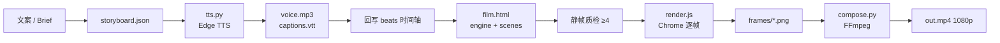

<div align="center">

# 动效工坊 Pro
### Motion Craft Pro

**用代码，拍出 Claude Opus 5.5 同款动效审美。**

*Programmatic motion graphics with Claude Opus 5.5 editorial taste —*  
*storyboard first · subtle spring · word-level captions · 1080p by default.*


<br/>


&nbsp;&nbsp;&nbsp;


<br/><br/>

**技能 `motion-craft` · 专家 `motion-director` · WorkBuddy 可直接上架 · Apache-2.0 开源**

[快速开始](#7-快速开始--quick-start) ·
[七步工作流](#8-工作流七步详解) ·
[场景 API](#9-场景组件-api) ·
[WorkBuddy 发布](#10-workbuddy-发布技能包-vs-专家包) ·
[对标说明](#2-对标说明--benchmark)

</div>

---

## 目录 · Table of Contents

1. [一句话定位](#1-一句话定位)
2. [对标说明](#2-对标说明--benchmark)
3. [为什么开源](#3-为什么开源--why-open-source)
4. [功能矩阵](#4-功能矩阵--capability-matrix)
5. [架构一览](#5-架构一览--architecture)
6. [仓库结构](#6-仓库结构)
7. [快速开始](#7-快速开始--quick-start)
8. [工作流七步详解](#8-工作流七步详解)
9. [场景组件 API](#9-场景组件-api)
10. [WorkBuddy 发布](#10-workbuddy-发布技能包-vs-专家包)
11. [审美规范摘要](#11-审美规范摘要--claude-opus-55-contract)
12. [与完整 Remotion 栈的差异](#12-与完整-remotion--hyperframes-栈的差异)
13. [License & Contributing](#13-license--contributing)
14. [Star / Release](#14-star--release)

---

## 1. 一句话定位

| | 中文 | English |
|---|---|---|
| **产品** | 动效工坊 Pro | Motion Craft Pro |
| **是什么** | 分镜优先的**程序化动效**管线：Canvas 逐帧 + Edge TTS + FFmpeg | Storyboard-first **code-driven** motion pipeline |
| **对标** | **Claude Opus 5.5** 写代码做片的审美与导演习惯 | Claude Opus 5.5 code-to-motion taste & director habits |
| **不是什么** | 不是可灵 / 即梦 / Runway 写实生成视频 | Not photoreal AI video generators |
| **交付** | 默认 **1920×1080** H.264 MP4，软字幕 / 烧录可选 | Default 1080p H.264 with soft or burned captions |

> 画面由代码画出来。配音由 TTS 生成。合成由 FFmpeg 完成。  
> 高级感来自**导演纪律**，不来自堆特效。

---

## 2. 对标说明 · Benchmark

### 对标对象（写清楚）

本仓库**明确对标**：**Claude Opus 5.5**（用户口中的「克劳德 5.5 最强模型」）在公开工作流里常用的那一类成片方式——

| Claude Opus 5.5 侧常见做法 | Motion Craft Pro 的对齐方式 |
|---|---|
| 用代码（Remotion / HTML / React）写戏，而不是抽像素 | Canvas `renderFrame(t)` 纯函数逐帧绘制 |
| 分镜 / Composition 先于渲染 | `storyboard.json` + Schema，**先审再渲** |
| Spring 物理、克制 overshoot | `spring` / `springSeg`，damping ≈ 16–18 |
| 编辑感字体：大留白、精确字距、冷静色板 | Claude palette + tracking + ≥8% margin |
| 字幕进时间轴，音画对齐 | Edge TTS + WordBoundary / 短语级 VTT |
| 静帧验收，再整段出片 | 强制 ≥4 张静帧质检，再全时长渲染 |
| 数字说话，不写「大气一点」 | beats 里写 px / s / hold，禁止形容词指挥 |

### 技术路线对齐

```
Claude Code + Remotion / HyperFrames 一类「代码成片」
                    │
                    ▼
     Motion Craft Pro（轻量导演栈）
     storyboard → TTS → stills QA → Chrome frames → FFmpeg
```

**对标的是审美与工作流，不是某条公开样片的逐像素复制。**  
目标：同一赛道上，观感与导演纪律逼近 Opus 5.5 写动效的成片标准。

---

## 3. 为什么开源 · Why open source

| 原因 | 说明 |
|---|---|
| **可审计** | 每一帧都是 `t` 的纯函数；没有黑盒生成模型 |
| **可上架** | 技能包 / 专家包已按 WorkBuddy 扁平两级规则打好 |
| **可扩展** | 六个场景组件 + Schema；你可以加第七个，不必重写引擎 |
| **可复现** | 同 storyboard + 同 TTS + 同 Chrome → 同帧序列 |
| **可商用友好** | **Apache-2.0**（相对部分 Remotion 商用条款更省事） |

Open source so directors, skill authors, and agents share one contract:  
**numbers over adjectives · stills before full render · restraint over noise.**

---

## 4. 功能矩阵 · Capability Matrix

### 画面 · Picture

| 能力 | 状态 | 细节 |
|---|---|---|
| 默认画幅 | ✅ | **1920×1080**；亦支持 1440×1080 / 1080×1920 / 1080×1080 |
| Spring 缓动 | ✅ | Remotion 风格阻尼弹簧；轻微 overshoot |
| 场景组件 | ✅ | TitleBeat / BulletReveal / StatCounter / CompareBars / QuoteCard / EndCard |
| 字距 / 中文折行 | ✅ | `drawTracked` + `wrapCN` |
| 色板 | ✅ | 炭黑底 · 暖白字 · 克制青铜强调色 `#c4a574` |
| 幕间淡出 | ✅ | `beatAlpha` 入场 / 离场 |
| 确定性渲染 | ✅ | 禁止 `Date.now()` / `Math.random()` |

### 声音 · Audio

| 能力 | 状态 | 细节 |
|---|---|---|
| Edge TTS | ✅ | 多音色；推荐中文 `zh-CN-YunxiNeural`，`rate=-6%` |
| 字幕时间轴 | ✅ | JSON + VTT；有 WordBoundary 则按字，否则短语级 |
| BGM 闪避 | ✅ | `compose.py` 可选人声侧链闪避 |
| 软字幕 / 烧录 | ✅ | mov_text 或 ffmpeg `subtitles`（需 libass） |

### 管线 · Pipeline

| 能力 | 状态 | 细节 |
|---|---|---|
| 分镜 Schema | ✅ | `storyboard.schema.json` |
| 依赖自检 | ✅ | `compose.py --check` |
| Chrome 逐帧 | ✅ | `puppeteer-core` + 本机 Chrome/Chromium |
| 静帧质检门 | ✅ | 技能契约：≥4 张关键静帧通过再全渲 |
| WorkBuddy 打包 | ✅ | `build.py` → 技能 zip + 专家 zip |

### 交付 · Delivery

| 能力 | 状态 | 细节 |
|---|---|---|
| 容器 | ✅ | H.264 MP4 |
| 码率取向 | ✅ | 适合讲解 / 产品发布短片（非写实电影） |
| 发布资产 | ✅ | `dist/` 内可直接上传 WorkBuddy 的两包 |

---

## 5. 架构一览 · Architecture

### 数据流



### ASCII（无 Mermaid 时）

```
Brief ──► storyboard.json ──► tts.py ──► voice + captions
                │                              │
                └──── 回写 start/end ◄─────────┘
                              │
                              ▼
                    film.html + engine.js + scenes.js
                              │
                              ▼
                    静帧质检（开场/中段/数据/收尾）
                              │
                              ▼
              render.js (Chrome) ──► frames/ ──► compose.py ──► MP4
```

### 运行时分层（每一帧）

```
背景 → 光晕 → 装饰 → 场景组件内容 → 字幕 → 后期遮罩
                 ▲
           全部 = f(t) 纯函数
```

---

## 6. 仓库结构

```
motion-craft-pro/
├── README.md                      ← 你正在读的文档
├── README.expert.md               ← 打进专家包的短版说明
├── LICENSE                        ← Apache-2.0
├── CONTRIBUTING.md
├── GITHUB_UPLOAD.txt              ← 网页拖拽上 GitHub 逐步说明
├── .gitignore
├── build.py                       ← 重打包技能 / 专家 zip
├── SKILL.md                       ← 专家侧入口元数据
├── .codebuddy-plugin/
│   └── plugin.json                ← WorkBuddy 专家清单
├── agents/
│   └── motion-director.md
├── avatars/
│   └── expert.png                 ← 512×512
├── skills/
│   └── motion-craft/              ← 技能本体（扁平，无子目录）
│       ├── SKILL.md               ← name: motion-craft
│       ├── engine.js              ← Spring / 色板 / 绘制原语
│       ├── scenes.js              ← 六大场景组件
│       ├── render.js              ← Chrome 逐帧导出
│       ├── film.html              ← 舞台入口
│       ├── storyboard.json        ← 示例分镜
│       ├── storyboard.schema.json
│       ├── tts.py
│       └── compose.py
├── docs/
│   ├── PUBLISH_WORKBUDDY.md       ← 发布排错完整清单
│   └── assets/
│       ├── skill_icon_512.png
│       └── expert_avatar_512.png
├── dist/                          ← 可直接上传 WorkBuddy
└── releases/                      ← 同 dist，便于 GitHub Release 附件
```

---

## 7. 快速开始 · Quick Start

### 7.1 依赖

| 依赖 | 最低要求 | 用途 |
|---|---|---|
| Node.js | 18+ | `render.js` |
| puppeteer-core | 最新稳定 | 驱动本机 Chrome |
| Chrome / Chromium | 本机已装 | 逐帧截图 |
| Python | 3.9+ | `tts.py` / `compose.py` |
| edge-tts | `pip install edge-tts` | 配音 + 边界事件 |
| FFmpeg | **完整版** | 合成（不要用 Playwright 自带精简版） |

### 7.2 安装与自检

```bash
pip install edge-tts
npm i puppeteer-core

SKILL="$PWD/skills/motion-craft"
python "$SKILL/compose.py" --check
```

`--check` 会核对 FFmpeg、Python 模块与关键路径。全部绿灯再往下走。

### 7.3 一条最短成片命令链

```bash
SKILL="$PWD/skills/motion-craft"
WORK="/tmp/mc-pro-demo"
mkdir -p "$WORK"

# 1) 配音 + 字幕
python "$SKILL/tts.py" \
  --text "高级动效，不靠堆特效。克制的留白、精确的字距、轻微的弹簧回弹。" \
  --out "$WORK/voice.mp3" \
  --voice zh-CN-YunxiNeural \
  --rate=-6% \
  --captions-json "$WORK/captions.json" \
  --captions-vtt "$WORK/captions.vtt"

# 2) 渲染帧（示例 18s @ 30fps；冒烟可先改短）
node "$SKILL/render.js" "$SKILL/film.html" "$WORK/frames" 30 18

# 3) 合成 1080p
python "$SKILL/compose.py" \
  --frames "$WORK/frames" \
  --voice-file "$WORK/voice.mp3" \
  --captions "$WORK/captions.vtt" \
  --out "$WORK/out.mp4" \
  --duration 18
```

正式片请按下一节的**七步**走：分镜 → TTS → 回写时间轴 → 填舞台 → 静帧 → 全渲 → 合成。

---

## 8. 工作流七步详解

> 这是 Opus 5.5 式导演习惯在本仓库的落盘版。**不要跳步。**

### Step 1 — 写分镜 JSON（先于一切代码）

复制 `skills/motion-craft/storyboard.json`，按 `storyboard.schema.json` 填写：

- `meta`：画幅、时长、旁白全文、音色、强调色
- `beats[]`：`id, start, end, type, copy, visual`
- `type`：六大组件名（或短别名 `title` / `stat` / …）

**数字说话，不写形容词。**

```json
{
  "id": "hook",
  "start": 0.0,
  "end": 3.6,
  "type": "TitleBeat",
  "copy": {
    "label": "MOTION CRAFT PRO ／ 审美",
    "title": "克制，才是高级感",
    "sub": "对标 Claude Opus 5.5 代码动效"
  }
}
```

错误示范：「标题大气一点、动画炫一点」。  
正确示范：「标题 86px、入场 0.9s、hold 2.2s、damping 17」。

### Step 2 — TTS，拿到真实时长

```bash
python "<技能目录>/tts.py" \
  --text-file narration.txt \
  --out "<工作目录>/voice.mp3" \
  --voice zh-CN-YunxiNeural \
  --rate=-6% \
  --captions-json "<工作目录>/captions.json" \
  --captions-vtt "<工作目录>/captions.vtt"
```

### Step 3 — 用真实音频回写时间轴

用 `voice.mp3` 实测时长改写 `beats[].start/end` 与 `meta.duration`。  
**禁止**先拍脑袋锁死秒数再配音。

> 字幕：若 Edge 返回 WordBoundary → 按字聚合；多数中文音色仅 SentenceBoundary → 脚本按逗号/顿号切短语级 VTT。

### Step 4 — 填 `film.html` 舞台

- 同目录引用 `engine.js`、`scenes.js`（禁止 `../assets/`）
- 调用 `MCScenes.drawScene(ctx, W, H, t, beat, layout)`
- 右侧装饰可手写，正文尽量走场景组件

### Step 5 — 静帧质检（门禁）

至少导出并肉眼验收 **4** 张：开场、中段、数据/对比、收尾。

检查清单：

- [ ] 无叠层 / 溢字  
- [ ] 不过暗、对比足够  
- [ ] 对齐与边距 ≥ 短边 8%  
- [ ] 字幕可读、不挡关键信息  

不通过 → 改分镜或样式 → **不要**进入全时长渲染。

### Step 6 — 全量渲染

```bash
node "<技能目录>/render.js" \
  "<工作目录>/film.html" \
  "<工作目录>/frames" \
  30 \
  18
```

### Step 7 — FFmpeg 合成与质检

```bash
python "<技能目录>/compose.py" \
  --frames "<工作目录>/frames" \
  --voice-file "<工作目录>/voice.mp3" \
  --captions "<工作目录>/captions.vtt" \
  --out "<工作目录>/out.mp4" \
  --duration 18
```

合成脚本会做时长 / 音轨 / 封装层面的强校验。失败即停，不产出「看起来有文件其实坏了」的假成片。

---

## 9. 场景组件 API

全部挂在全局 `MCScenes`（依赖先加载 `engine.js` → `MC`）。  
签名统一：

```js
Component(ctx, W, H, t, beat, layout?)
// 或
MCScenes.drawScene(ctx, W, H, t, beat, layout?)
```

| 组件 | 别名 | `beat.copy` 关键字段 | 用途 |
|---|---|---|---|
| **TitleBeat** | `title` | `label?`, `title`, `sub?` | 开场大标题，编辑感字距 |
| **BulletReveal** | `bullets` | `label?`, `items[{k,title,desc}]` | 逐条揭示原则 / 要点 |
| **StatCounter** | `stat` | `value`, `prefix?`, `suffix?`, `label?`, `caption?` | 大数字滚动；`visual.from` 可设起点 |
| **CompareBars** | `compare` | `label?`, `title?`, `items[{label,value}]`, `note?` | 对比柱 |
| **QuoteCard** | `quote` | `quote`, `attribution?` | 中心金句 / 关键句 |
| **EndCard** | `end` | `title`, `sub?`, `brand?` | 收尾 CTA / 品牌 |

调度示例：

```js
for (const beat of storyboard.beats) {
  MCScenes.drawScene(ctx, W, H, t, beat, layout);
}
```

扩展新场景：在 `scenes.js` 增加纯函数绘制，并在 `drawScene` 的 `map` 与 Schema `enum` 里登记即可。

---

## 10. WorkBuddy 发布：技能包 vs 专家包

### 对照表（最重要）

| 上传到哪里 | 用哪个文件 | Zip 根目录必须有 | 关键 `name` |
|---|---|---|---|
| **技能** 发布页 | `dist/motion-craft-pro-skill-v2.0.0.zip` | `SKILL.md` + 引擎（**扁平**） | **`motion-craft`** |
| **专家** 发布页 | `dist/expert-motion-craft-pro-v2.0.0.zip` | `.codebuddy-plugin/plugin.json` | **`motion-director`** |

### 已修复的字段（v2.0.0）

| 字段 | 要求 | 当前值 |
|---|---|---|
| `tags` | **正好 3 个** | 动效视频 / 分镜优先 / Claude 审美 |
| `defaultInitPrompt.zh/en` | 必须等于 `quickPrompts[0].zh/en` | 已对齐 |
| `profession.zh` | 同类型资产唯一 | **`程序化动效导演`** |
| `profession.en` | — | `Programmatic Motion Director` |
| 头像 / 技能图标 | **512×512 PNG** | `avatars/expert.png` · `docs/assets/skill_icon_512.png` |

### 传错包会发生什么

| 误操作 | 典型报错 |
|---|---|
| 技能页 ← 专家包 | name 与资产不一致（`motion-director` ≠ `motion-craft`） |
| 专家页 ← 技能包 | `未找到 .codebuddy-plugin/plugin.json` |
| `tags` 写了 4 个 | `tags 须固定 3 个` |
| `profession.zh` 撞名 | `该名称「…」已被使用` |

完整排错：[docs/PUBLISH_WORKBUDDY.md](docs/PUBLISH_WORKBUDDY.md)

重新打包：

```bash
python build.py
# → dist/ 与 releases/ 下两个 zip（内容在 zip 根，无外层包装目录）
```

---

## 11. 审美规范摘要 · Claude Opus 5.5 Contract

把下面当作**硬契约**，不是建议：

| # | 规则 | 参数 |
|---|---|---|
| 1 | 默认画幅 | **1920×1080** |
| 2 | 一屏一件事 | 幕间淡出；长 hold、短飞入 |
| 3 | Spring | damping ≈ **16–18**；禁止满屏弹性狂欢 |
| 4 | 留白 | 外边距 ≥ 短边 **8%** |
| 5 | 色板 | 正文暖白 `#f4f1ea`；强调青铜 `#c4a574`；炭黑底 |
| 6 | 字体层级 | 标题加字距；层级字号差 ≥ **1.5×** |
| 7 | 配音 | 先行；导出边界字幕 |
| 8 | 质检门 | 先 ≥4 张静帧，再全时长 |
| 9 | 纯函数 | `renderFrame(t)` 禁止 `Date.now()` / `Math.random()` |
| 10 | 语言 | 分镜里写数字，不写形容词 |

**Claude palette（默认）**

| Token | Hex | 用途 |
|---|---|---|
| Background | `#0b0b0b` 一带 | 炭黑舞台 |
| Ink | `#f4f1ea` | 暖白正文 |
| Ink Dim / Faint | 降不透明度暖白 | 次级信息 |
| Accent | `#c4a574` | 克制青铜点缀 |
| Accent Soft | 半透明青铜 | 辅助强调 |

---

## 12. 与完整 Remotion / HyperFrames 栈的差异

诚实，且自信：

| 维度 | 完整 Remotion 等 | Motion Craft Pro |
|---|---|---|
| UI 框架 | React 组件树 + Studio | 轻量 Canvas + 场景助手 |
| 分布式渲染 | 有 | 无（本机 Chrome 逐帧） |
| Lottie / Three.js | 生态成熟 | **默认不内置**（可自行扩 `film.html`） |
| 商用许可 | 部分场景需额外条款 | **Apache-2.0** 整仓 |
| WorkBuddy 上架 | 需自行裁剪目录 | **开箱扁平两级**，zip 可直接传 |
| 审美契约 | 靠作者习惯 | **写进 SKILL + Schema + 质检门** |

我们不对标「Remotion 每一个 API」。  
我们对标 **Claude Opus 5.5 写动效时的审美与导演纪律**，并把它做成可发布、可复现、可审计的技能。

---

## 13. License & Contributing

**Apache License 2.0** — 见 [LICENSE](LICENSE)。

贡献前请读 [CONTRIBUTING.md](CONTRIBUTING.md)：审美契约、扁平目录、`plugin.json` 三标签规则、512 头像，全部是合并门槛。

Copyright 2026 Contributors

---

## 14. Star / Release

如果这套管线帮你少走弯路：

1. **Star** 本仓库 — 让更多人看到「代码成片」也可以很克制、很整齐。  
2. 在 **Releases** 下载：
   - `motion-craft-pro-skill-v2.0.0.zip` → WorkBuddy **技能**页  
   - `expert-motion-craft-pro-v2.0.0.zip` → WorkBuddy **专家**页  
3. 网页上传步骤：[GITHUB_UPLOAD.txt](GITHUB_UPLOAD.txt)

---

<div align="center">

### 克制，才是高级感。

**动效工坊 Pro · Motion Craft Pro v2.0.0**  
对标 Claude Opus 5.5 代码动效审美 · 分镜先行 · 静帧质检 · 1080p 交付

*Not photoreal AI video. Code. Taste. Discipline.*

</div>
